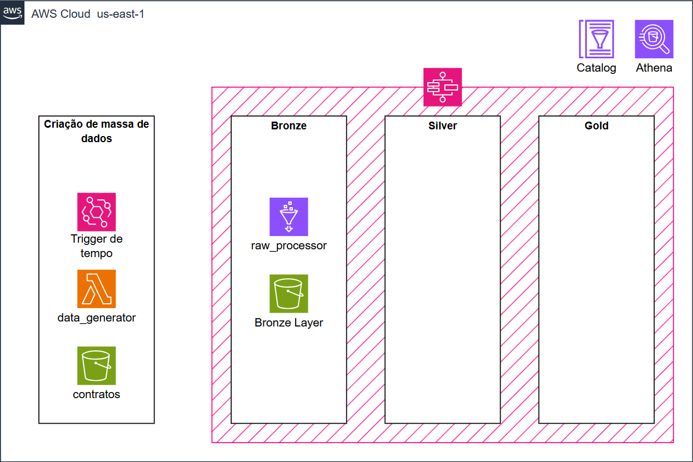

# Projeto Desafio AWS- Engenharia de dados

## Visão geral
Este projeto está sendo desenvolvido como solução para um desafio de engenharia de dados.

## Arquitetura


## Estrutura
```
.
├── generate_layer/                 # 1. Geração de dados fictícios (Lambda)
│   ├── app/
│   │   ├── src/data_generator/
│   │   │   ├── contas.csv
│   │   │   ├── contratos.csv
│   │   │   ├── data_faker.py
│   │   │   └── handler.py
│   │   ├── tests/
│   │   │   ├── test_faker.py
│   │   │   └── test_handler.py
│   │   ├── lambda_function.py
│   │   └── requirements.txt
│   └── infra/
│       └── scripts/build_layer.sh
├── sor_layer/                      # 2. Bronze (Glue)
│   ├── app/
│   │   ├── src/
│   │   │   ├── raw_processor_job.py
│   │   │   ├── raw_transformacoes.py
│   │   │   └── raw_processor.py   # versão anterior, em arquivo único
│   │   └── tests/test_raw_transformacoes.py
│   └── infra/
├── sot_layer/                      # 3. Silver (Glue)
│   ├── app/
│   │   ├── src/
│   │   │   ├── sot_job.py
│   │   │   └── sot_transform.py
│   │   └── tests/test_sot_transform.py
│   └── infra/
├── spec_layer/                     # 4. Gold (Glue)
│   ├── app/
│   │   ├── src/
│   │   │   ├── business_views/
│   │   │   ├── spec_job.py
│   │   │   └── spec_transform.py
│   │   └── tests/
│   └── infra/
├── infra/                          # Recursos compartilhados: bucket do data lake e Step Functions
├── docs/
├── requirements.txt
├── .gitignore
├── .env
└── README.md
```

Cada pasta `infra/` é um projeto Terraform independente (`terraform init`/`apply` dentro dela).

## 1.Geração de dados fictícios
A Lambda funciona como etapa de simulação da origem dos dados:

- `DataCreator` lê os identificadores das contas e associa contratos fictícios.
- `LambdaHandler` gera os registros, cria um arquivo Parquet usando Polars e grava o resultado no S3.
- Os identificadores da conta: `id_conta`, `cod_agencia` e `cnpj` são lidos do CSV `contas.csv` e armazenados como strings para preservar zeros à esquerda.
- Os identificadores dos contratos: `id_contrato` e `tipo_contrato` são lidos do CSV `contratos.csv` utilizando o `id_conta`.
- Os demais dados da transação, valores e datas, são gerados para fins de teste.

#### `contas.csv`

Contém os identificadores das contas:

```csv
id_conta,cod_agencia,cnpj
2960,3719,09LY7FEP8ZZ7M
0003,6157,0L8KQFJRQH9QW
```

#### `contratos.csv`

Contém os contratos associados a cada conta:

```csv
id_contrato,tipo_contrato,id_conta
87f5fd2e-069d-4931-9af4-09c4a529fe06,SEGURO,2960
1ca63482-772c-4fcf-a4f1-132386c7d5d7,CC,0003
```

O nome `id_conta` deve existir nos dois arquivos. O gerador usa esse campo como chave para encontrar os contratos da conta selecionada:

```text
contas.csv -- id_conta --> contratos.csv
```

Os identificadores devem ser lidos como strings para preservar zeros à esquerda. O campo `cnpj` de treze caracteres alfanuméricos é sintético e não representa um CNPJ fiscal válido.

### Geração de transações

O `DataCreator` realiza as seguintes etapas:

1. Lê os identificadores do `contas.csv`.
2. Lê os contratos do `contratos.csv` e cria uma estrutura indexada por `id_conta`.
3. Seleciona uma conta e busca os contratos associados ao `id_conta` dela.
4. Gera os registros transacionais.
5. Retorna os registros para o `LambdaHandler`.

Todos os registros de uma execução recebem o mesmo `id_lote`, o que permite identificar e reprocessar cada lote gerado.

#### Tipos e valores dos lançamentos

O `tipo_lancamento` é sorteado com pesos, e o `valor_lancamento` é sorteado dentro de uma faixa própria de cada tipo
(atributo `_PERFIL_LANCAMENTO` do `DataCreator`):

| Tipo | Peso | Faixa de valor |
|---|---|---|
| `CREDITO` | 45% | 100,00 a 5.000,00 |
| `DEBITO` | 40% | 10,00 a 5.000,00 |
| `TARIFA` | 7% | 5,00 a 80,00 |
| `IOF` | 4% | 1,00 a 50,00 |
| `JUROS` | 4% | 5,00 a 300,00 |

Os pesos e as faixas foram calibrados para que, na conta corrente, as entradas (`CREDITO`) e as saídas se equilibrem: em média um
lançamento soma cerca de +135, e os saldos ficam distribuídos em torno de zero, com leve viés positivo. O valor é sempre positivo, com
duas casas decimais; o sinal (entrada ou saída) é aplicado na Silver, na coluna `valor_assinado`. O `flag_estorno` é verdadeiro em
cerca de 5% dos registros.

#### Erros propositais

Para exercitar as regras de qualidade da Silver, o gerador pode criar erros de propósito. Com `taxa_erros` maior que zero, cada registro tem essa
chance de ser gerado com erro, sendo metade das vezes:

- **chave nula**: `id_transacao`, `id_conta` ou `id_contrato` é gravado como nulo;
- **duplicata**: o registro é substituído por uma cópia de um registro anterior do mesmo lote (mesmo `id_transacao`).

A quantidade total de registros não muda, e a contagem dos erros injetados é registrada no log e devolvida na resposta da Lambda (`erros_injetados`).

O contrato de dados do desafio define `id_conta` e `cod_agencia` como strings. Também descreve os campos transacionais como identificador da transação, contrato, tipo de lançamento, valor, datas, classificação COSIF e indicador de estorno.

### Execução da Lambda

#### Configuração

A Lambda é criada pelo Terraform (veja "Infraestrutura"), que já define as variáveis de ambiente:

- `BUCKET_DESTINO`: bucket S3 de destino.
- `PREFIXO_DESTINO`: prefixo em que os Parquet serão gravados.

A role de execução da Lambda precisa de `s3:PutObject` no prefixo de saída. Como o CSV está no pacote implantado, não é necessário `s3:GetObject` para lê-lo.

O ponto de entrada é a função `lambda_handler` do `generate_layer/app/lambda_function.py`, configurada no campo **Manipulador** como:

```text
generate_layer.app.lambda_function.lambda_handler
```

#### Evento de teste

```json
{
  "quantidade": 1000,
  "data_particao": "2025-02-10T14:30:00Z",
  "taxa_erros": 0.02
}
```

- `quantidade`: número de transações a gerar (padrão 1000). A quantidade de contas disponíveis é determinada pelas linhas do CSV.
- `data_particao`: data e hora da partição; sem ela, é usada a data e hora UTC da execução.
- `taxa_erros`: fração (0 a 1) dos registros gerados com erro proposital (padrão 0).

### Infraestrutura (Terraform)

A infraestrutura da camada fica em `generate_layer/infra/` e cria:

- O bucket de destino (`desafio-aws-contratos`) já existe e é apenas referenciado, não é criado pelo Terraform.
- Lambda Layer com `polars` e `Faker` (`generate_layer/app/requirements.txt`). O zip passa de 50 MB e por isso é publicado no prefixo `artefatos/` do bucket de destino.
- Lambda `data-generator` (Python 3.12) com o código e os CSVs de contas/contratos, gravando em `contratos/`.
- Agendamento no EventBridge Scheduler de segunda a sexta às 6h, 14h e 20h (`America/Sao_Paulo`), gerando `quantidade_registros` transações com `taxa_erros` (padrão 0,02) de erros propositais.
- Roles IAM com permissão mínima (`s3:PutObject` no prefixo de saída e `lambda:InvokeFunction` para o agendamento) e log group no CloudWatch.

```bash
./generate_layer/infra/scripts/build_layer.sh   # gera infra/build/layer.zip
cd generate_layer/infra
terraform init
terraform plan
terraform apply
```

Rode o `build_layer.sh` novamente sempre que `generate_layer/app/requirements.txt` mudar. As variáveis (agendamento, quantidade, memória, etc.) estão em `variables.tf`.

### Saída no S3

Os registros são gravados em formato Parquet com compressão Zstandard, em um caminho particionado por ano, mês, dia e hora UTC:

```text
<prefixo>/AAAA/MM/DD/HH/part-<uuid>.parquet
```

## 2.Bronze (sor)
A camada Bronze é executada no `AWS Glue` que extrai os dados fictícios gerados na etapa anterior de bucket no `S3` e salva os dados no formato `Iceberg`
no prefixo `bronze/` do bucket do data lake (`desafio-aws-datalake`) e no catalógo do glue, no database `bronze`. A execução é orquestrada pelo `AWS Step Functions`.

A leitura dos dados é feita via DynamicFrame e passada para Dataframe e escrita em Iceberg V3 e uma versão alternativa com o sufixo `_alt` é criada
devido a incompatibilidade do Iceberg V3 com Athena. As tabelas `bronze.transacoes` e `bronze.transacoes_alt` são particionadas por `dt_processamento`.

Antes da gravação, o job aplica o contrato de dados gerado pela Lambda: seleciona as colunas do contrato, na ordem do contrato, convertidas para os tipos
esperados (`valor_lancamento` como `decimal(18,2)`, por exemplo). Se faltar alguma coluna, o job falha com uma mensagem indicando as colunas ausentes.

O código fica dividido em dois arquivos:

- `raw_processor_job.py`: script do job, que lê os parâmetros e os Parquet de origem e grava as tabelas.
- `raw_transformacoes.py`: classe `Bronze` com as regras, sem dependência do `awsglue`, o que permite testá-las localmente com PySpark e pytest.

### Parâmetros do job Glue

| Parâmetro | Exemplo | Uso |
|---|---|---|
| `--bucket_origem` | `desafio-aws-contratos` | Bucket de origem; os Parquet são lidos do prefixo `contratos/`. |
| `--bucket_bronze` | `desafio-aws-datalake` | Bucket do data lake (o warehouse das tabelas é definido no `--conf`). |
| `--extra-py-files` | `s3://<bucket-artefatos>/scripts/raw_transformacoes.py` | Disponibiliza o `raw_transformacoes.py` para o job. |
| `--datalake-formats` | `iceberg` | Habilita o formato Iceberg no job. |
| `--conf` | Configurações Spark do Iceberg | Define extensões, catálogo, warehouse (`s3://desafio-aws-datalake/bronze/`) e implementação de I/O. |

### Testes

```bash
.venv/bin/python -m pytest sor_layer/app/tests
```

## 3.Silver (sot)
A camada Silver é executada no `AWS Glue` e lê a tabela Iceberg `bronze.transacoes` pelo catálogo do Glue. Ela aplica as regras de qualidade, padroniza
e enriquece os dados, e grava o resultado no formato `Iceberg` no prefixo `silver/` do bucket do data lake e no catálogo do glue, no database `silver`.

Assim como na Bronze, são gravadas duas tabelas particionadas por `dt_processamento`: `silver.transacoes` (Iceberg V3) e `silver.transacoes_alt` (Iceberg V2),
esta última para leitura pelo Athena. Se a tabela já existir, apenas as partições presentes nos dados são substituídas.

O código fica dividido em dois arquivos:

- `sot_job.py`: script do job, que lê os parâmetros, chama as regras e grava as tabelas.
- `sot_transform.py`: classe `SotTransform` com as regras, sem dependência do `awsglue`, o que permite testá-las localmente com PySpark e pytest.

### Regras de qualidade

As regras são aplicadas antes das transformações, nesta ordem:

1. **Chaves obrigatórias**: registros com `id_transacao`, `id_conta`, `id_contrato` ou `dt_processamento` nulos (ou texto vazio) são separados, com o motivo
   da rejeição (ex.: `chave nula: id_conta, id_contrato`).
2. **Duplicatas**: é mantido um registro por `id_transacao`, o de `dt_processamento` mais recente (desempate por `dt_lancamento` e `id_lote`); os demais são separados.

Os registros rejeitados são gravados em tabela Iceberg V2 para fins de auditoria.

### Transformações

| Coluna | Regra |
|---|---|
| `tipo_contrato`, `tipo_lancamento`, `cod_cosif` | Padronizados com `trim` e letras maiúsculas. |
| `categoria_produto` | `CC` e `POUP` → `CONTA`; `CDB` e `LCI` → `INVESTIMENTO`; `SEGURO` e `CONSORCIO` mantêm o nome. Contrato não mapeado fica nulo. |
| `ano_mes` | Mês do lançamento no horário de Brasília (`America/Sao_Paulo`), no formato `AAAA-MM`. |
| `dias_ate_processamento` | Dias entre a data do lançamento e `dt_processamento` (ambos em UTC). |
| `valor_assinado` | `valor_lancamento` com sinal: positivo para entrada de dinheiro na conta do cliente e negativo para saída (regra abaixo). |
| `dt_load_sot` | Data e hora (UTC) da carga Silver; o mesmo valor para todas as linhas e tabelas de uma execução. |
| `id_execucao` | `JOB_RUN_ID` da execução do Glue que gravou a linha. |

O sinal de `valor_assinado` segue a natureza do lançamento:

- `CREDITO` é positivo; `DEBITO`, `TARIFA` e `IOF` são negativos.
- `JUROS` é positivo nos contratos em que é rendimento pago ao cliente (`POUP`, `CDB`, `LCI`) e negativo nos demais (`CC`, `CONSORCIO`, `SEGURO`).
- Quando `flag_estorno` é verdadeiro, o sinal é invertido (ex.: um débito estornado devolve o dinheiro ao cliente).

### Parâmetros do job Glue

| Parâmetro | Exemplo | Uso |
|---|---|---|
| `--tabela_origem` | `glue_catalog.bronze.transacoes` | Tabela da Bronze lida pelo catálogo. |
| `--database_destino` | `silver` | Database das tabelas da Silver, criado se não existir. |
| `--extra-py-files` | `s3://<bucket-artefatos>/scripts/sot_transform.py` | Disponibiliza o `sot_transform.py` para o job. |
| `--datalake-formats` | `iceberg` | Habilita o formato Iceberg no job. |
| `--conf` | Configurações Spark do Iceberg | Define extensões, catálogo, warehouse (`s3://desafio-aws-datalake/silver/`) e implementação de I/O. |

### Testes

```bash
.venv/bin/python -m pytest sot_layer/app/tests
```

## Orquestração (Step Functions)

A state machine `aws-desafio-state-machine` (`infra/sfn.tf`) executa as camadas em sequência, usando a integração síncrona do Glue (`startJobRun.sync`):
cada etapa aguarda a conclusão do job antes de seguir.

```text
Bronze (aws-desafio-sor-etl-job) -> Silver (aws-desafio-sot-etl-job) -> Gold (aws-desafio-spec-etl-job, uma execução por business view)
```

Na etapa Gold, cada business view listada na variável `business_views` (`infra/variables.tf`) roda em paralelo, como uma execução do job Gold
com o parâmetro `--business_view`. Para incluir uma nova view na orquestração, basta acrescentar o nome do arquivo à lista.

- Se um job falhar, a etapa faz até duas tentativas adicionais, com intervalo de duas horas entre as tentativas.
- Se todas as tentativas falharem, a execução do workflow termina com falha e as etapas seguintes não são executadas.
- A saída de cada etapa guarda o nome do job, o `JobRunId` e o estado final da execução.

## 4.Gold (spec)